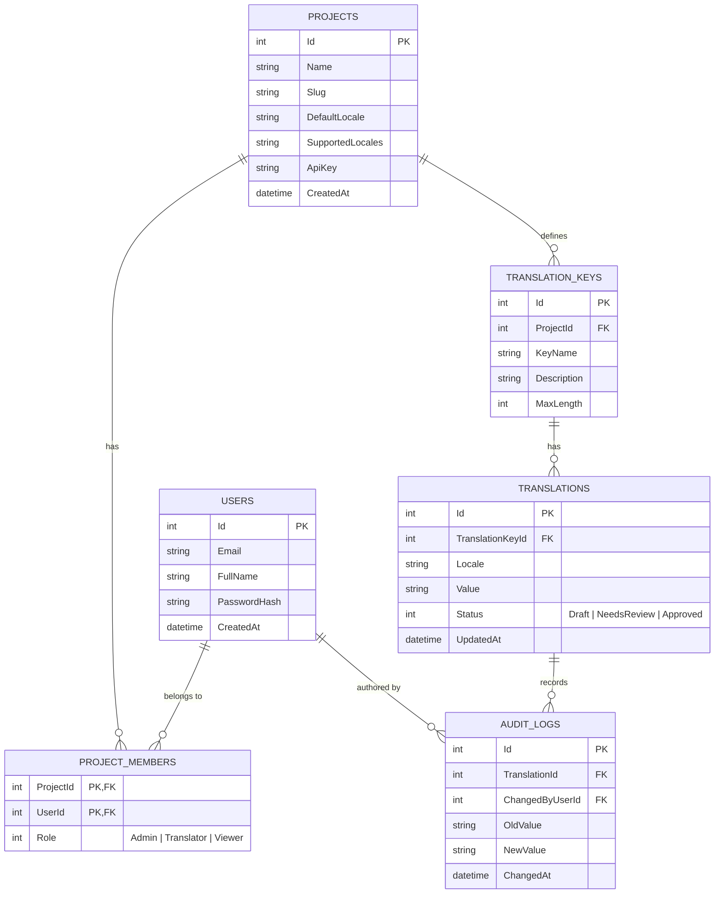

# LocaleFlow 🌐
> **Multi-Tenant Localization & Translation Management Engine**

LocaleFlow is an enterprise-ready localization backend and web management platform built with **ASP.NET Core**, **C#**, **Entity Framework Core**, **MySQL**, and **React**. It streamlines multilingual software localization workflows, providing workspace isolation, role-based access control, file compilation (.json and .resx), fallback resolution, and append-only audit tracking.

---

## 🚀 Key Features

- **Workspace-Based Multi-Tenancy**: Complete row-level workspace partitioning. Each project defines its default source locale and supported target languages.
- **3-Tier Role-Based Access Control (RBAC)**:
  - **Admin**: Create keys, invite/manage team members, bulk import/export, and approve translations.
  - **Translator**: Add and update translated strings across target languages.
  - **Viewer**: Read-only access to keys, translations, and audit history.
- **Automated Fallback Engine**: Missing translations automatically resolve to the project's source default string during file generation and delivery.
- **Append-Only Audit History**: Every edit records before-and-after text diffs, editor identity, and UTC timestamps.
- **Bulk File Ingestion & Compilation**: High-performance streaming parser for standard `.json` key-value pairs and .NET XML `.resx` files.
- **Layout Overflow Protection**: Optional `MaxLength` validation per key to prevent text truncation in fixed-width UI designs (e.g. desktop WPF or mobile interfaces).
- **Minimal, Responsive Management Client**: Built with React 18, TypeScript, and Tailwind CSS.

---

## 🛠️ Architecture & Tech Stack

### Backend
- **Framework**: ASP.NET Core 10 (Minimal APIs & Modular Endpoints)
- **Language**: C# 13
- **ORM**: Entity Framework Core 9 (Pomelo MySQL Provider)
- **Database**: MySQL 8.0
- **Security**: Stateless JWT Authentication, BCrypt Password Hashing, Claims & Database-backed RBAC
- **Validation**: Fluent / Model-level constraints and streaming XML/JSON parsing

### Frontend
- **Framework**: React 18 with TypeScript
- **Bundler**: Vite
- **Styling**: Tailwind CSS (Clean, minimal light-mode UI)
- **Icons**: Lucide React
- **HTTP Client**: Axios with Bearer token interceptor

---

## 📐 Database Schema Overview



---

## 📡 API Endpoints

### 🔐 Authentication (`/api/auth`)
| Method | Endpoint | Access | Description |
| :--- | :--- | :--- | :--- |
| `POST` | `/api/auth/register` | Public | Register a new user |
| `POST` | `/api/auth/login` | Public | Authenticate user & issue JWT |
| `GET` | `/api/auth/me` | Authenticated | Retrieve current user profile |

### 📁 Projects & Localization (`/api/projects`)
| Method | Endpoint | Minimum Role | Description |
| :--- | :--- | :--- | :--- |
| `POST` | `/api/projects` | Authenticated | Create a new localization workspace |
| `GET` | `/api/projects` | Authenticated | List all workspaces caller has access to |
| `POST` | `/api/projects/{id}/members` | **Admin** | Invite/update member role in workspace |
| `POST` | `/api/projects/{id}/keys` | **Admin** | Create a new translation key |
| `GET` | `/api/projects/{id}/keys` | **Viewer** | Fetch keys (with search & missing locale filters) |
| `PUT` | `/api/projects/{id}/keys/{keyId}/translations` | **Translator** | Upsert translation string (creates audit log) |
| `PATCH` | `/api/projects/{id}/translations/{transId}/approve`| **Admin** | Mark translation status as Approved |
| `GET` | `/api/projects/{id}/translations/{transId}/history` | **Viewer** | View append-only audit diff history |

### 📥 File Ingestion & Export (`/api/projects/{id}`)
| Method | Endpoint | Minimum Role | Description |
| :--- | :--- | :--- | :--- |
| `POST` | `/api/projects/{id}/import` | **Admin** | Bulk upload `.json` or `.resx` strings |
| `GET` | `/api/projects/{id}/export` | **Viewer** | Export compiled `.json` or `.resx` with fallback |

---

## ⚙️ Getting Started

### Prerequisites
- [.NET 9 or 10 SDK](https://dotnet.microsoft.com/)
- [Node.js (v18+)](https://nodejs.org/) & `npm`
- [Docker Desktop](https://www.docker.com/) (or local MySQL 8.0)

### 1. Start MySQL Database
```bash
docker run -d --name localeflow-mysql -p 3306:3306 -e MYSQL_ROOT_PASSWORD=DevPassword123! -e MYSQL_DATABASE=localeflow_db mysql:8.0
```

### 2. Run the Backend API
```bash
cd LocaleFlow.Api
dotnet run
```
The API starts on:
- HTTP: `http://localhost:5044`
- HTTPS: `https://localhost:7197`
- Swagger UI: `http://localhost:5044/swagger`

*(Initial admin account `admin@localeflow.dev` / `AdminPassword123!` is seeded automatically on boot).*

### 3. Run the Frontend Client
```bash
cd frontend
npm install
npm run dev
```
Open [http://localhost:3000](http://localhost:3000) or [http://localhost:3001](http://localhost:3001) in your browser.

---

## 👤 Author
**Sarthak Mahadik**
- GitHub: [@OceanicCoder09](https://github.com/OceanicCoder09)
- Email: sarthakmahadik.connect@gmail.com
